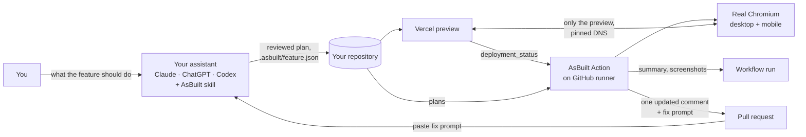

# Architecture

AsBuilt has one verification engine and two ways to run it: **the GitHub Action** (the main product, free, nothing to host) and **the local app** (a review UI and MCP server for development). Detailed rationale for the original design is in [docs/architecture.md](docs/architecture.md).

## The GitHub version

**The agent is split on purpose.** Your assistant does the part that needs judgment: understanding intent, reading the PR, drafting checks. AsBuilt does the part that needs independence: observing the real preview with fixed rules and no AI. The assistant can't grade its own work, and AsBuilt's verdicts are reproducible and free.

## Layers

| Layer | Files | Responsibility |
| --- | --- | --- |
| GitHub entry point | `action.yml`, `server/action.ts` | Read plan files, run them against the workflow's preview URL, write summary, screenshots and the PR comment. |
| Local interfaces | `src/`, `server/index.ts`, `server/mcp.ts`, `server/stdio.ts` | Review UI, HTTP API and MCP tools for development. Same engine. |
| Assistant plugin | `plugins/asbuilt/` | Skill and template: plan, set up, explain. |
| Planning | `server/schema.ts` (plan rules), `server/agent.ts` (optional OpenAI planner, local only) | Plans are bounded and validated; output is always unverified until run. |
| Product coverage | `server/product-review*.ts`, `src/product-reviews.tsx` | Requirement maps, frozen scenarios and coverage from evidence (local app). |
| Execution | `server/runner.ts`, `interactive.ts`, `*-worker.mjs`, `observation.mjs`, `interaction-policy.mjs`, `sign-in.mjs` | Drive the browser, observe, decide Pass, Fail or Not verified. |
| Safety | `server/safety.ts`, `browser-network.ts`, `tunnel-proxy.mjs` | Allowlist, SSRF defense, budgets, Vercel bypass scoping. |
| Reporting | `server/pr-comment.ts`, `server/github.ts` | Inert PR comments, fix prompts, GitHub App reads (local). |

## Key decisions and tradeoffs

1. **GitHub-only distribution, no hosted service.** *Why:* zero cost, nothing to operate, works with any assistant that can edit a repo (ChatGPT included), and access control is just GitHub's. *Tradeoff:* checks run on previews after a push, not interactively; screenshots live in workflow artifacts (14 days), not a dashboard.
2. **Evidence states are computed, never asserted.** Only the browser produces Pass, Fail or Not verified. *Tradeoff:* more "Not verified" results, which is honest but less satisfying.
3. **Blockers aren't defects.** Sign-in walls, protected previews, HTTP errors and blocked scripts make a missing outcome Not verified, with the reason. *Tradeoff:* a real defect on such a page reads as "couldn't check".
4. **Plans are code.** One reviewed JSON file per feature, in the repo, rechecked on every PR. *Why:* review happens in the PR diff, and regressions are caught automatically. *Tradeoff:* someone has to keep plans current as features change (the skill helps).
5. **Test accounts from secrets only, typed only on the preview.** *Tradeoff:* no one-time codes, CAPTCHAs or outside identity providers.
6. **Deterministic browser policy over AI browsing.** A fixed set of reviewed actions; no model drives the browser. *Tradeoff:* it can't explore. It also can't be talked into clicking "Buy".
7. **Docker isolation for untrusted page JavaScript**, already available on GitHub's runners. *Tradeoff:* about a minute to build the worker image on the first interactive run.

## Data

GitHub version: plans in `.asbuilt/`; results in the run's job summary, one PR comment, and the `asbuilt-evidence` artifact (`report.json`, `screenshots/<feature>/desktop.png` and `mobile.png`, kept 14 days). Nothing is stored anywhere else.

Local app: `ASBUILT_DATA_DIR` (default `.data/`, git-ignored) holds reports, screenshots, product reviews, sessions and the access key. Writes are write-then-rename. Limits: 200 reports and 100 product reviews.
