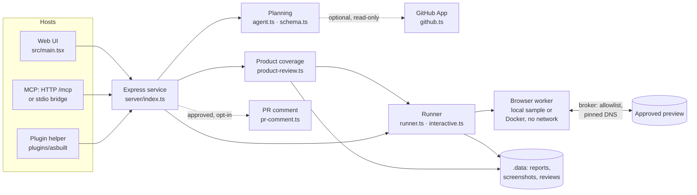

# Architecture

AsBuilt is one small Node service with three front doors (a web UI, an MCP server and a plugin helper) over one verification engine. Detailed rationale for the original design is in [docs/architecture.md](docs/architecture.md). This page is the current map, including the product coverage layer added in 0.5.0.

## Layers

| Layer | Files | Responsibility |
| --- | --- | --- |
| Interfaces | `src/`, `server/mcp.ts`, `server/stdio.ts`, `plugins/asbuilt/` | Collect intent, show plans for approval, show evidence. No verification logic. |
| Service | `server/index.ts` (local), `server/cloud/` (hosted) | Auth, routing, error mapping (`errors.ts`). |
| Planning | `server/agent.ts`, `server/schema.ts` | Turn intent into bounded, reviewable checks. Output is always `not_run`. |
| Product coverage | `server/product-review.ts`, `product-review-store.ts`, `src/product-reviews.tsx` | Requirement maps with cited sources, frozen scenarios, revisions, coverage computed from evidence. |
| Execution | `server/runner.ts`, `interactive.ts`, `*-worker.mjs`, `observation.mjs`, `interaction-policy.mjs` | Drive the browser, observe, decide pass / fail / not verified. |
| Safety | `server/safety.ts`, `browser-network.ts`, `tunnel-proxy.mjs` | Target allowlist, SSRF defense, request budgets. |
| Integrations | `server/github.ts`, `pr-comment.ts` | Read PRs and commits; optional approved comment. |

## Key decisions and tradeoffs

1. **Evidence states are computed, never asserted.** Only the runner produces pass, fail or not verified, and product coverage derives "verified" from linked runs. *Tradeoff:* more "Not verified" results, which is honest but less satisfying.
2. **The host assistant plans; AsBuilt executes.** Claude or Codex reads the user's context and drafts the requirement map. AsBuilt validates citations, freezes scenarios and runs them. *Tradeoff:* plan quality depends on the host and is unmeasured (see EVALS.md). No second model subscription is needed.
3. **Frozen scenarios and immutable revisions.** A changed requirement creates a new revision that starts untested; old evidence stays on the old revision. *Tradeoff:* re-running after every revision, but a stale pass can never vouch for a changed build.
4. **Blockers aren't defects.** A missing outcome on an erroring page, a sign-in wall, or a page with blocked scripts is Not verified with an explanation. *Tradeoff:* a real defect on such a page is reported as "couldn't check" rather than "failed".
5. **Local, single operator first.** Loopback binding, one key, JSON files. *Tradeoff:* no teams, no ChatGPT web connection (it needs a public HTTPS server), one shared run history. Fast to set up, small attack surface, and right for dogfooding and a private beta.
6. **Deterministic browser policy over AI browsing.** The browser runs a fixed set of reviewed actions; no model drives it. *Tradeoff:* it can't explore. It also can't be talked into clicking "Buy".
7. **Docker for untrusted page JavaScript.** External interactive pages run with no network; a parent-process broker fetches only approved resources. *Tradeoff:* Docker is required for interactive previews.

## Data

All state lives in `ASBUILT_DATA_DIR` (default `.data/`, git-ignored): `report-<id>.json`, `<id>/*.png`, `product-<id>.json`, `sessions.json`, `token`. Writes are write-then-rename. Limits: 200 reports and 100 product reviews. Hosted mode uses Postgres (Neon) tables of the same shape, plus Vercel Blob for screenshots.
