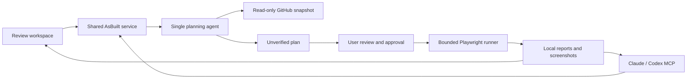

# Architecture decisions

## One agent, bounded tools

The planning agent lives in `server/agent.ts`. It decides which allowed source files to read, then returns structured proposed checks and verifiable source citations. Browser execution is a separate deterministic capability invoked after human review, never a model-generated shell script. The UI and MCP server are adapters to the same service, not independent agents.

## Separate truth states

A source citation is evidence of source text, not deployed behavior. The planning output always says `verificationStatus: not_run`. Only the runner creates pass/fail/not_verified observations. Reports preserve intent, exact criteria, source SHA when attached, target, browser version, viewports, time, reproduction steps, screenshots and limitations. No aggregate “release ready” score is computed.

## Local single-operator boundary

The service binds to loopback. UI login exchanges a local bearer secret for an opaque HttpOnly, SameSite=Strict session cookie. API, screenshots and MCP require authentication; Host and Origin checks reduce cross-origin and DNS-rebinding exposure. Cookies are not Secure because this local-only server uses HTTP; hosted deployment must use TLS and a different auth architecture. Anyone with the bearer token has the operator's capabilities. There is no tenant isolation or delegated user identity.

Secrets stay in ignored environment files or external PEM files. No tokens are returned to the UI. A selected repository's installation token is explicitly scoped and short-lived. There are no webhooks in this release.

## Browser safety over broad coverage

Static mode disables JavaScript and uses checked, pinned network retrieval. Interactive mode interprets a bounded approved click/fill/select schema; it never executes model-generated code. Each criterion receives a fresh context. Only the trusted bundled sample runs in a local worker process. External page JavaScript requires a non-root, network-disabled Docker worker with no host mounts or app secrets. A bounded stdio broker retrieves only allowed documents and static assets through the pinned-address policy. Blocked resources, script failures and absent evidence prevent a pass. Container launch, fixture interactions and denied broker responses are validated; real preview acceptance remains pending; see [Phase 2](phase2.md).

## Storage

Local JSON snapshots use write-then-rename. Screenshots are placed beneath UUID run directories. A single process is supported; shared-volume or multi-process writes are not. Corrupt JSON is skipped at startup; interrupted jobs become interrupted. Local files are not an append-only audit log and are not tamper-proof. Historical comparisons/regression detection are future work.

## Models are replaceable; the policy is not

The current adapter uses OpenAI Responses API function calling and structured output. MCP hosts may contribute intent and proposed criteria, but cannot gain additional runner actions through natural-language instructions. Source text is treated as data; path/tool allowlists and schema checks enforce boundaries outside the model. Prompt injection can still distort a proposal, so user review remains mandatory.

## Minimal dependencies and portability

React and Vite provide the interface. Express hosts a single service. Zod enforces request/model schemas. Playwright owns observations. The MCP SDK owns protocol details. JSON persistence keeps setup small. A Rollup WebAssembly override avoids a macOS library-signing incompatibility with the Node runtime bundled in this workstation's desktop application. No paid cloud account is needed for the guided sample.

## Remembered local sessions

Opt-in remembered sessions expire after 30 days and survive server restarts. Only SHA-256 digests, expirations and an access-key fingerprint persist in the ignored owner-only .data/sessions.json file. The browser holds the opaque random token in an HttpOnly cookie, never the workspace key. Unremembered sessions remain in memory, have an eight-hour server expiry and no persistent browser expiry. Sign out revokes only the current session; rotating the workspace key invalidates stored sessions on restart. Storage is capped at 100 sessions and saved by atomic rename. This remains local single-operator authentication, not hosted multi-user login.
